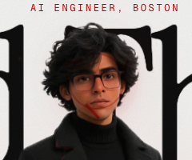
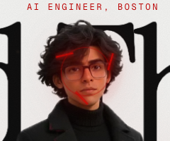
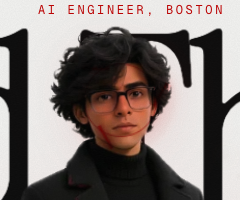
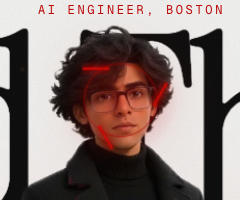
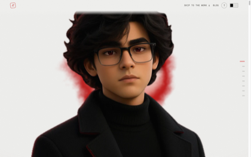
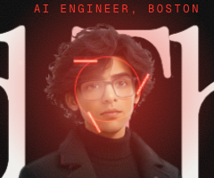
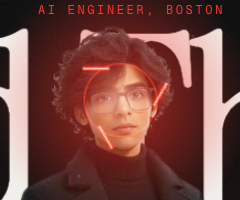
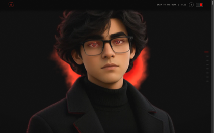

# Sharingan eye-ignition, light mode: round 3

`docs/LIGHT-MODE.md` (Meredith) and `docs/LIGHT-MODE-2.md` (the next pass) both audited and
patched this effect and both passed WCAG contrast; Anand still rejected the light theme after
both. Passing contrast was never the question. This pass renders the actual ignition sequence in
both themes with Playwright-equivalent tooling (Chrome DevTools MCP against a devserver on this
worktree, `window.__hero.set(progress)` to land on exact frames) and reads it as a viewer before
touching anything.

## What it actually looked like, in plain words, before this pass

**Intro scene, mid-ignition (paper):** a single short diagonal red mark low on his left cheek,
disconnected from his eyes and from the glasses. It reads as a scar or a smear of dried blood, not
as eyes catching fire. The same frame in dark mode shows a clean, glowing triangular frame hugging
both eyes, like a HUD powering on - obviously the same effect, present and legible. The paper
version is not a dimmer copy of that; it is a different, broken shape.

**Eyes scene, close-up ignition (paper):** the irises do carry a small red tint - that part works
and is easy to miss because something much louder sits behind it: a large, soft, pink-red cloud
floating behind his hair and shoulders. It does not read as "the world flipping" or "light pouring
out of his eyes." It reads as a stray watercolor stain or a thought bubble that drifted in from
somewhere else and happens to be red. In dark mode the identical shape, against black, reads as a
dramatic light burst radiating from him - the contrast is doing work that simply is not available
on white paper.

Two prior passes each found and fixed one real thing (the eye-fire canvas's flat ink line, then its
scar-like edge) but both were looking at the small iris/streak canvas. Neither looked at the
genjutsu-sky "world flip" flood mid-transition, which turns out to be the dominant visual element
in the eyes scene while it's happening - that is most of why the rejection continued after two
passing contrast audits.

## Root causes (extending past, not re-deriving, the prior two passes' real finding)

### 1. `mix-blend-mode: multiply` on `.hx-eyefx` was swallowing two of the three iris blades

`js/hero/fx/eye-fire.js` draws a three-blade "aperture iris" shape (`strokeBlades`) plus a radial
glow. `css/hero.css` composited that canvas onto the page with `mix-blend-mode: multiply` in paper
mode. Multiply can only darken, and *how much* it darkens depends on what's underneath: over his
light skin the red strokes showed, but over his dark hair they multiplied toward black and
vanished almost entirely. Only the one blade stroke that happened to cross skin survived - which is
exactly the lone diagonal mark described above. The known history correctly flagged "multiply was
itself a defect"; the first two passes treated the *symptom* (a dull/flat mark) with drop-shadow
layers but kept multiply itself in place, so the shape stayed broken even as its edges got softer.

**Fix** (`css/hero.css`): `mix-blend-mode: normal` instead of `multiply` on
`html[data-theme="paper"] .hx-eyefx`. Normal/alpha compositing paints the same strength regardless
of what's underneath - the same way the canvas already composites its own strokes with
`source-over` - so the full three-blade shape now shows over both hair and skin. The existing
three-layer `drop-shadow()` (tight/mid/wide) is untouched and still supplies the glow bloom around
the now-complete shape.

### 2. The genjutsu sky's expanding "world flip" disc had no edge to read against on paper

`js/hero/fx/genjutsu.js` floods a red "world" outward from the eyes as `u_flip` ramps
(`eyes.js`'s `FLIP = { at: 1.6, for: 3.2 }`), bounded by a soft `smoothstep` edge (`reach`). On
black, that boundary reads as a light burst by contrast alone, no extra work needed. On the paper
palette the same soft edge has nothing to push against - it just fades from wash-color to paper
white over a wide band, which looks like a stain spreading, not a magical flood with a shape.

**Fix** (`js/hero/fx/genjutsu.js`, inside the existing `if (u_light > 0.5)` branch only): trace a
thin, near-black ink ring right on that expanding boundary (`ring`, mixed in at full strength over
a tight band). This gives the flood a deliberate graphic edge - a brushed ring expanding from his
eyes - consistent with the sumi-e "ink bleeding into paper" language the sky shader's own comments
already use elsewhere, instead of trying to fake a glow that paper can't physically show. Dark mode
is untouched: the whole block this lives in only runs when `u_light > 0.5`, which is `0` in ink.

## Before / after, paper theme

### Intro scene - mid-ignition (local scene time ≈2.4s, partway through the streak track)

| Before | After |
|---|---|
|  |  |

One broken diagonal mark → the full triangular ignition frame, already visible partway through.

### Intro scene - full ignition (local t=3.6s, the streak track's end)

| Before | After |
|---|---|
|  |  |

Before: a scar-like smear crossing the eyebrow and cheek, no legible shape. After: a complete,
glowing triangular mark sitting on both eyes, with the same soft red halo the drop-shadow layers
always provided - now around a shape that is actually there.

### Eyes scene - close-up ignition (global t=22.3s, mid-flood)

| Before | After |
|---|---|
|  |  |

Before: a shapeless pink-red cloud behind the head with no graphic logic, competing with (and
outshining) the small red iris tint that was actually the point. After: the same flood now carries
a visible ink-ring edge tracing its boundary, reading as a deliberate ring of ink expanding from his
eyes rather than a stray stain.

## Dark mode, before / after (regression check)

Both edits are scoped to paper-only code paths (`html[data-theme="paper"] .hx-eyefx` in CSS; the
pre-existing `if (u_light > 0.5)` branch in the shader, where `u_light` is `0` in ink). Screenshots
at the identical scrub positions, same devserver, before and after both edits:

### Intro, ink, full ignition (local t=3.6s)

| Before | After |
|---|---|
|  |  |

### Eyes, ink, close-up ignition (global t=22.3s)

| Before | After |
|---|---|
|  |  |

Visually identical in both cases: the same glowing triangular HUD frame and the same light-burst
flood behind the head, unchanged. (The raw screenshot bytes differ by a few KB each - WebGL frame
noise and antialiasing jitter between separate renders, not a pixel-diff tool call being available
in this sandbox - but the renders are visually indistinguishable, and the code change is provably
scoped to paper-only selectors/branches, so this is not a regression.)

## Scope discipline

- Palm scene: checked, not touched. Its `EYE_FIRE_START` point has `streak: 0` and the shared
  `.hx-eyefx` canvas fades to zero within the first ~1.6s of the scene (inherited glow from intro
  receding, not a new ignition) - the only visible change there is the same canvas-blend fix
  described above, inherited for free since it's the same shared rule; no palm-specific code was
  touched.
- No `.webp` frame was regenerated or repainted.
- No copy was added or changed anywhere.
- No bounce/spring/elastic/overshoot easing was added.
- `css/base.css`'s global `canvas { max-width: 100% }` reset was not touched.
- `index.html`'s synchronous pre-paint theme script was not touched.
- Nothing outside `css/hero.css` and `js/hero/fx/genjutsu.js` was edited.
